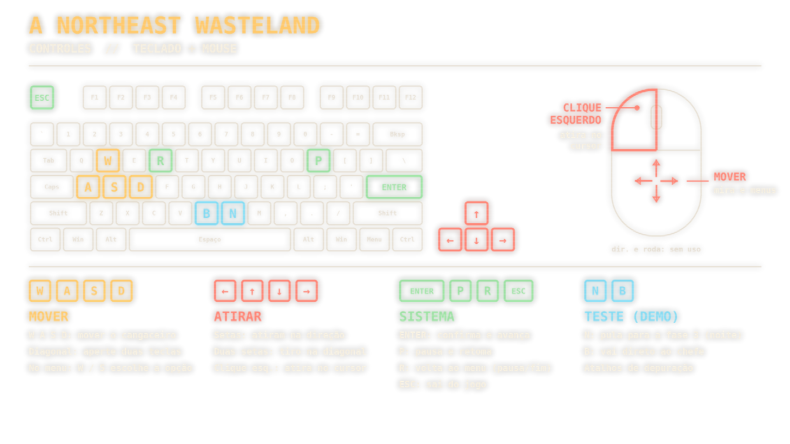

- - -

# A Northeast Wasteland: Console Digital com Coprocessador Gráfico em FPGA (DE1-SoC)

## Descrição do Projeto

Etapa final do console digital dedicado desenvolvido na disciplina. Nas fases anteriores, a equipe construiu o **coprocessador gráfico programável** em FPGA (Problemas 1 e 2), com *ISA* própria de 32 bits, fila de instruções, unidade de controle, bancos de registradores e motores de *background*, *sprites* e polígonos, além do *driver* em *Assembly* ARM que o acessa por *MMIO*. Nesta fase, o produto final foi entregue: o jogo ***A Northeast Wasteland***, um *shooter* 2D de visão superior em ambientação nordestina, escrito em linguagem C, executado no processador ARM (*HPS*) da DE1-SoC sob Linux, controlado por teclado e mouse USB e exibido em monitor VGA.

Toda a imagem é gerada pelo coprocessador. A aplicação em C não acessa registradores, não desenha *pixels* e não conhece os detalhes internos do hardware: ela calcula a física e o estado da partida e compõe a cena exclusivamente por meio da API do *driver* em *Assembly*. Para viabilizar o jogo, o coprocessador sofreu ajustes de hardware (64 *sprites*, RAM de padrões gravável, ROM de *tiles* ampliada e sinal de confirmação de aceitação, ou *ACK*), e o *driver* foi estendido com validação de parâmetros, tratamento de *timeouts* e códigos de erro padronizados, mantendo a compatibilidade com a *ISA* documentada no Problema 2.

## Contexto Acadêmico e Autoria

Este projeto foi desenvolvido como parte do componente curricular **TEC499 - MI Sistemas Digitais**, ministrado pelo professor **Wild Freitas da Silva Santos**, na **Universidade Estadual de Feira de Santana (UEFS)**, como parte da metodologia de Aprendizagem Baseada em Projetos (PBL).

**Equipe:**
* Airam Santos Macêdo ([@imthepassionfruit-lab](https://github.com/imthepassionfruit-lab));
* Nicolas Carvalho Pimentel ([@nicolascrp07](https://github.com/nicolascrp07));
* Walef Souza da Silva ([@walefsouza](https://github.com/walefsouza)).

## Sumário

1. [Requisitos Funcionais e Não Funcionais](#1-requisitos-funcionais-e-não-funcionais)
2. [O Produto: A Northeast Wasteland](#2-o-produto-a-northeast-wasteland)
3. [Arquitetura Geral do Sistema](#3-arquitetura-geral-do-sistema)
4. [Mudanças no Hardware](#4-mudanças-no-hardware)
5. [Driver em Assembly ARM e API](#5-driver-em-assembly-arm-e-api)
6. [Arquitetura de Software da Aplicação](#6-arquitetura-de-software-da-aplicação)
7. [Integração Hardware-Software](#7-integração-hardware-software)
8. [Software e Hardware usados para Prototipação](#8-software-e-hardware-usados-para-prototipação)
9. [Demonstração e Testes de Funcionamento](#9-demonstração-e-testes-de-funcionamento)
10. [Análise de Recursos e de Desempenho](#10-análise-de-recursos-e-de-desempenho)
11. [Instalação, Configuração e Execução](#11-instalação-configuração-e-execução)
12. [Decisões Técnicas Registradas](#12-decisões-técnicas-registradas)
13. [Limitações e Possíveis Melhorias](#13-limitações-e-possíveis-melhorias)
14. [Referências Bibliográficas](#14-referências)

## 1. Requisitos Funcionais e Não Funcionais

Os requisitos abaixo foram levantados a partir do enunciado do Problema 3 (seções 3 e 4) e organizados por camada.

### **1.1. Funcionais:**

* **RF01**: Aplicação do jogo em linguagem C, executada no processador ARM (*HPS*) da DE1-SoC sob Linux, com saída em monitor VGA.
* **RF02**: Tela de abertura e menu inicial, partida com pontuação e progressão de dificuldade, pausa, reinício e fim de jogo com exibição da pontuação final.
* **RF03**: Lógica do jogo estruturada como máquina de estados finitos (abertura, partida, transição, pausa e fim de jogo/vitória).
* **RF04**: Mecânica com pontuação, movimentação de objetos e eliminação de inimigos e agrupamentos (bandos), conforme a proposta do problema de referência.
* **RF05**: Leitura simultânea de teclado e mouse USB conectados à placa, com movimentação, mira, disparo e pausa por entradas combinadas.
* **RF06**: Atualização da cena exclusivamente por meio da API do *driver* (tiles, *sprites* e polígonos), sem bibliotecas gráficas de terceiros e sem desenho por *pixel* no processador.
* **RF07**: *Driver* em *Assembly* ARM com API estável, validação de parâmetros, carregamento de recursos gráficos, comandos de desenho, controle de quadro e consulta de status.
* **RF08**: Tratamento da sincronização com o coprocessador (*valid*, *busy*, *done*) e dos comandos inválidos, com propagação de erro até a aplicação.
* **RF09**: Medição de desempenho integrada: atualizações da lógica por segundo, taxa de vídeo, latência de entrada, latência de comandos e uso de CPU.

### **1.2. Não Funcionais:**

* **RNF01**: Taxa de atualização da lógica de, no mínimo, **30 atualizações por segundo**.
* **RNF02**: Resposta a comandos de entrada em, no máximo, **100 ms**.
* **RNF03**: Imagem estável, sem perda de sincronismo, durante toda a execução.
* **RNF04**: Arquitetura modular em camadas (aplicação em C, *driver* em *Assembly*, coprocessador em FPGA), com a lógica do jogo isolada do hardware.
* **RNF05**: Ajustes no coprocessador devem preservar a compatibilidade com a *ISA* documentada no Problema 2.
* **RNF06**: Fechamento de *timing* do domínio de 25 MHz do coprocessador, sem violações de *setup* e *hold*.
* **RNF07**: Fluxo de compilação e instruções de execução reproduzíveis a partir do repositório.

## 2. O Produto: A Northeast Wasteland

<div align="center">
  
  <br>
  <i>Figura 1: Esquema de controles e capturas de tela do jogo.</i>
</div>
<br>

<!-- INSERIR: slide 3 (PRODUTO: A NORTHEAST WASTELAND), esquema de controles + capturas das fases manhã e noite -->

O jogo coloca o jogador no papel de um cangaceiro que enfrenta, em três fases (manhã, tarde e noite), ondas de inimigos inspirados na fauna e no folclore do sertão. A fase avança conforme as ondas se esgotam, e a última termina com um chefe.

### 2.1. Controles

| Entrada | Ação |
|:---|:---|
| **W A S D** | Movimentação do cangaceiro (diagonal por combinação de duas teclas) |
| **Setas** | Disparo na direção indicada (duas setas: diagonal) |
| **Mouse (movimento)** | Posição da mira e navegação nos menus |
| **Mouse (botão esquerdo)** | Disparo na direção do cursor; confirma botões nos menus |
| **ENTER** | Confirma e avança (menu, transição, fim de jogo); retoma a partida na pausa |
| **P** | Pausa e retoma a partida |
| **R** | Volta ao menu (a partir da pausa ou do fim de jogo) |
| **ESC** | Encerra o jogo |



> [!NOTE]
> As teclas **N** e **B** são atalhos de depuração que levam diretamente à fase 3 e ao chefe, respectivamente, e existem apenas para demonstração e teste.

### 2.2. Fases e inimigos

<div align="center">

Fase | Ondas | Inimigos | Observações
:---|:---|:---|:---
Manhã | 3 | calango (persegue), marimbondo (aproxima, para e dispara), cacto (lento, atira espinhos) | Onda 1 apenas com calangos
Tarde | 3 | cascavel (persegue em zigue-zague), urubu (bando que cruza a tela) | Velocidades alternadas por fileira no bando
Noite | 2 + chefe | morcego (voo errático, em bando), corpo-seco, escorpião, lobisomem (elite, a partir da onda 2) | O chefe alterna perseguição, investida e garras em leque

</div>

### 2.3. Itens (*power-ups*)

O jogo possui uma tabela de nove itens, com duração em quadros (60 Hz) e peso no sorteio de *drop*:

<div align="center">

Item | Tipo | Efeito
:---|:---|:---
Bacamarte | Arma (10 s) | Tiro triplo em leque
Estrela | Arma (8 s) | Tiro em 8 direções
Cartucheira | *Buff* (10 s) | Cadência de tiro dobrada
Rapadura | *Buff* (10 s) | Velocidade +50%
Cantil | Instantâneo | Escudo que absorve 1 dano
Fogueira | Instantâneo | Elimina os inimigos comuns da tela (exceto o chefe)
Coração | Instantâneo | +1 vida (até 3)
Moedas | Instantâneo | +50 ou +250 pontos

</div>

## 3. Arquitetura Geral do Sistema

O sistema é organizado nas três camadas exigidas pelo enunciado. A aplicação em C só conhece a API do *driver*; o *driver* é a única fronteira com o hardware; e o coprocessador gera continuamente o sinal VGA.

<div align="center">
  
  <br>
  <i>Figura 2: Arquitetura em três camadas (aplicação C, driver Assembly e coprocessador FPGA).</i>
</div>
<br>

<!-- INSERIR: diagrama de três camadas (pode ser gerado a partir de arquitetura_do_projeto.txt ou refeito no estilo dos slides) -->

<details>
<summary><h3>Versão textual do diagrama de camadas</h3></summary>

```text
+-----------------------------------------------------------------------------+
|                          CAMADA DE APLICAÇÃO (Linguagem C)                  |
|  +-------------------+  +-----------------------+  +---------------------+  |
|  | Máquina de        |  | Mecânica e Lógica     |  | Leitura de Entradas |  |
|  | Estados (FSM)     |  | (Hitboxes, Pontuação) |  | (Teclado e Mouse)   |  |
|  +--------+----------+  +-----------+-----------+  +----------+----------+  |
|           +-------------------------+-------------------------+             |
|                         +-----------v-----------+                           |
|                         |  Gerenciador de Cena  |                           |
|                         |  (Chamadas da API)    |                           |
|                         +-----------+-----------+                           |
+-------------------------------------|---------------------------------------+
                                      | Convenção de Chamadas ARM (Parâmetros)
+-------------------------------------v---------------------------------------+
|                          CAMADA DE DRIVER (Assembly ARM)                    |
|  +-------------------+  +-----------------------+  +---------------------+  |
|  | API Estável       |  | Handshake / Sincronia |  | Mapeamento MMIO     |  |
|  | (Rotinas Gráficas)|  | (Valid, Busy, Done)   |  | (Ponte HPS-FPGA)    |  |
|  +-------------------+  +-----------------------+  +---------------------+  |
+-------------------------------------|---------------------------------------+
                                      | Barramento AXI / Sinais de Controle
+-------------------------------------v---------------------------------------+
|                       CAMADA DE HARDWARE (Coprocessador FPGA)               |
|         (Background, Sprites, Polígonos, Fila de Instruções, Sinal VGA)     |
+-----------------------------------------------------------------------------+
```

</details>

### 3.1. Responsabilidades por camada

* **Aplicação (C):** laço principal, máquina de estados, física, colisões, inteligência dos inimigos, leitura de teclado e mouse, e composição da cena. Opera sobre estruturas em RAM e nunca manipula bits da *ISA*.
* ***Driver* (*Assembly* ARMv7):** mapeia a ponte *Lightweight HPS-to-FPGA* via `/dev/mem`, valida os parâmetros, monta a palavra de 32 bits da *ISA* com a instrução `bfi` e executa o protocolo de sincronização com a FPGA.
* **Coprocessador (FPGA):** recebe as instruções em uma *FIFO*, decodifica e atualiza os bancos de registradores, e gera a imagem VGA de forma contínua, independente da execução das instruções.

### 3.2. Pipeline de um comando gráfico

```text
gfx_sprite() ─► movspr() ─► enviar_inst() ─► PIO_INSTR/PIO_CTRL ─► FIFO (32) ─► UC ─► banco ─► motor ─► compositor ─► VGA
   (C)           (ASM)        (ASM)             (ponte LW)            (FPGA)
```

## 4. Mudanças no Hardware

Para que o coprocessador atendesse às necessidades do jogo, o hardware do Problema 2 recebeu os ajustes resumidos abaixo. Nenhum deles altera o significado das instruções documentadas anteriormente: as instruções existentes continuam válidas, e a única instrução nova (PIXSPR) ocupa um *opcode* antes livre.

### 4.1. Resumo das alterações

<div align="center">

Item | Antes (Fase 2) | Depois (Fase 3)
:---|:---|:---
*Sprites* | 32 (ID de 5 bits) | 64 (ID de 6 bits)
Registro do *sprite* | padrão [30:26], X [23:15], Y [14:7], prioridade [6:2] | padrão [30:25], H [24], V [23], X [22:14], Y [13:6], prioridade [5:0]
Prioridade | 5 bits (0 a 31) | 6 bits (0 a 63)
Padrões de *sprite* | ROM fixa, 32 padrões | RAM gravável, 64 padrões
Endereço dos padrões | 13 bits | 14 bits
Escrita de *pixel* | não existia | instrução PIXSPR
ROM de *tiles* | 11 bits (2.048 posições, 32 *tiles*) | 14 bits (16.384 posições, 256 *tiles*)
Bit 2 do status | fifo_quase_cheia | ACK (*toggle* por *push* aceito)
Travessia de *clock* do ACK | não existia | 2 *flip-flops* (25 MHz → 50 MHz)
Campos da UC (*sprite*) | ID [9:5], X [26:18], Y [17:10] | ID [10:5], X [27:19], Y [18:11]
Restrição de *timing* do `clk_25` | não documentada na fase 2 | `create_generated_clock` no SDC

</div>

### 4.2. Sessenta e quatro *sprites*

O jogo precisa de uma quantidade de objetos simultâneos superior aos 32 *sprites* da fase anterior: o *pool* de entidades ocupa 47 IDs (jogador, até 12 obstáculos, inimigos, tiros e itens) e a interface (mira, vidas, pontos, ícones e texto) ocupa outros 17. Por isso, o `banco_sprites` passou a ter **64 registradores de 32 bits**, e o ID, o padrão e a prioridade passaram a 6 bits. O mapa de bits de cada registrador é:

<div align="center">

Bits | Campo | Descrição
:---|:---|:---
[31] | ATIVO | 1 = o *sprite* é desenhado
[30:25] | PADRÃO | Índice do padrão gráfico (0 a 63)
[24] | H | Espelhamento horizontal
[23] | V | Espelhamento vertical
[22:14] | X | Posição horizontal (0 a 511)
[13:6] | Y | Posição vertical (0 a 255)
[5:0] | PRIORIDADE | Prioridade na composição (0 a 63)

</div>

O banco continua com uma porta de leitura individual (usada pelo *read-modify-write* da UC) e exporta os 64 registradores em um barramento de 2.048 bits.

### 4.3. Atualização da *ISA*

A *ISA* passou a ter **19 instruções**. Os campos das instruções de *sprite* foram deslocados em 1 bit para acomodar o ID de 6 bits, e foi acrescentada a instrução PIXSPR no grupo de *sprites* (*opcode*[4:3] = 10).

<div align="center">

Grupo | *opcode*[4:3] | Instruções
:---|:---|:---
Controle | 00 | WAITVBLANK, PRICOMP
*Background* | 01 | DELBG, MOVBGX, PDRBG, MOVBGY
*Sprites* | 10 | INSSPR, DELSPR, MOVSPR, PDRSPR, INVSPR, PRISPR, **PIXSPR**
Polígonos | 11 | INSPOL, DELPOL, MOVPOL, COLPOL, INVPOL, TAMPOL

</div>

<details>
<summary><h3>Instruções de Sprites (formato atualizado)</h3></summary>

Todas as instruções de *sprites* usam o ID nos bits [10:5] (0 a 63).

#### INSSPR, PDRSPR e PRISPR

<div align="center">

Nome do Campo | Descrição | Tamanho | Bit final | Bit inicial
:---|:---|:---|:---|:---
Opcode | 10000 (INSSPR), 10011 (PDRSPR) ou 10101 (PRISPR) | 5 bits | 4 | 0
ID | Índice do *sprite* | 6 bits | 10 | 5
OP | Padrão (INSSPR, PDRSPR) ou prioridade (PRISPR), 0 a 63 | 6 bits | 16 | 11
Não usados | | 15 bits | 31 | 17

</div>

> **Atenção:** INSSPR ativa o *sprite* e zera posição, espelho e prioridade. Para que o *sprite* apareça no lugar desejado, deve-se enviar MOVSPR em seguida.

#### DELSPR

<div align="center">

Nome do Campo | Descrição | Tamanho | Bit final | Bit inicial
:---|:---|:---|:---|:---
Opcode | Código da operação (10001) | 5 bits | 4 | 0
ID | Índice do *sprite* | 6 bits | 10 | 5
Não usados | | 21 bits | 31 | 11

</div>

#### MOVSPR

<div align="center">

Nome do Campo | Descrição | Tamanho | Bit final | Bit inicial
:---|:---|:---|:---|:---
Opcode | Código da operação (10010) | 5 bits | 4 | 0
ID | Índice do *sprite* | 6 bits | 10 | 5
Y | Posição vertical (0 a 255) | 8 bits | 18 | 11
X | Posição horizontal (0 a 511) | 9 bits | 27 | 19
Não usados | | 4 bits | 31 | 28

</div>

#### INVSPR

<div align="center">

Nome do Campo | Descrição | Tamanho | Bit final | Bit inicial
:---|:---|:---|:---|:---
Opcode | Código da operação (10100) | 5 bits | 4 | 0
ID | Índice do *sprite* | 6 bits | 10 | 5
V | Espelho vertical | 1 bit | 11 | 11
H | Espelho horizontal | 1 bit | 12 | 12
Não usados | | 19 bits | 31 | 13

</div>

> **Nota:** nas instruções de polígonos, os campos H e V ficam em [11] e [10], respectivamente. Os formatos de polígono, *background* e controle permaneceram inalterados em relação à fase anterior.

#### PIXSPR (nova)

<div align="center">

Nome do Campo | Descrição | Tamanho | Bit final | Bit inicial
:---|:---|:---|:---|:---
Opcode | Código da operação (10110, 0x16) | 5 bits | 4 | 0
COR | Cor do *pixel* (RRRGGGBB; 0 = transparente) | 8 bits | 12 | 5
ENDEREÇO | {padrão[5:0], linha[3:0], coluna[3:0]} | 14 bits | 26 | 13
Não usados | | 5 bits | 31 | 27

</div>

Grava um *pixel* na RAM de padrões de *sprites*. O endereço de 14 bits comporta 64 padrões de 16×16 *pixels* (64 × 256 = 16.384 posições).

</details>

### 4.4. RAM de padrões de *sprites* e instrução PIXSPR

Na fase anterior, os desenhos dos *sprites* ficavam em uma ROM inicializada por arquivo `.mif`, o que exigia nova síntese a cada alteração de arte. Nesta fase, os padrões passaram para uma **RAM de duas portas de 16.384 posições × 8 bits** (`ram_sprites`), com blocos M10K:

* **porta de escrita:** alimentada pela UC ao executar PIXSPR (`pad_we`, `pad_addr`, `pad_data`);
* **porta de leitura:** consultada pelo motor de *sprites* com o endereço {padrão, linha, coluna}.

Com isso, o jogo carrega os desenhos em tempo de execução, pelo *driver*, e a mesma síntese serve a qualquer conjunto de *sprites*. O arquivo `padroes_sprites.mif` permanece como conteúdo inicial da memória.

> [!NOTE]
> Um padrão de 16×16 *pixels* custa 256 instruções PIXSPR. A entrada em uma partida carrega os 45 padrões comuns mais os da fase (7, 12 ou 18 padrões, conforme manhã, tarde ou noite), o que equivale a 13.312, 14.592 e 16.128 instruções, respectivamente. O menu carrega 38 padrões (9.728 instruções). O tempo real dessas cargas deve ser medido na placa (ver seção 10.3).

### 4.5. ROM de *tiles* ampliada

A ROM de padrões do *background* (`rom_tiles`, inicializada por `padroes_tiles.mif`) passou de 11 para **14 bits de endereço**, ou seja, de 2.048 para 16.384 posições de 8 bits. Como cada *tile* ocupa 64 posições (8×8 *pixels*), a capacidade foi de 32 para **256 *tiles* distintos**. O endereço é montado pelo `motor_background` como {tile_id[7:0], linha[2:0], coluna[2:0]}.

A instrução PDRBG permaneceu com o mesmo formato: ela grava o ID do *tile* (8 bits, [12:5]) em uma posição do *tilemap* (11 bits, [23:13]), com posições visíveis de 0 a 1.199 (linha × 40 + coluna). O que mudou foi o repertório de *tiles* disponível. Os *pixels* dos padrões continuam residindo em ROM, definidos em síntese, enquanto o mapa (qual *tile* está em cada célula) é escrito em tempo de execução.

### 4.6. Registrador de status e confirmação de aceitação (ACK)

O bit 2 do registrador de status, antes ocupado pela *flag* fifo_quase_cheia, passou a ser o **ACK**: um bit que **alterna (*toggle*) a cada instrução efetivamente aceita pela FIFO**. A alternância só ocorre quando há escrita solicitada e a fila não está cheia (`fifo_hab_escrita && !fifo_cheia`). Uma tentativa de escrita com a fila cheia não gera ACK e ativa a *flag* de *overflow*.

<div align="center">

Bits | Campo | Descrição
:---|:---|:---
[0] | fifo_vazia | Fila sem instruções pendentes
[1] | fifo_cheia | Fila com 32 instruções
[2] | **ack_toggle** | **Alterna a cada instrução aceita pela FIFO**
[3] | uc_ocupada | UC executando ou com instruções pendentes
[4] | esperando_vblank | UC parada em ESPERA_VBLANK
[5] | erro_opcode | Um *opcode* inválido foi descartado
[6] | em_vblank | Varredura dentro do *vertical blank*
[7] | front_sel | Página do *frame buffer* exibida no momento
[23:8] | contador_quadros | Contador de quadros de 16 bits
[24] | overflow | Houve tentativa de escrita com a fila cheia
[31:25] | done_cnt | Contador de instruções concluídas (circular, 7 bits)

</div>

Como o ACK é um *toggle*, e não um pulso, o ARM o enxerga mesmo lendo o status por consulta (*polling*): basta comparar o valor lido antes do envio com o valor lido depois. A indicação de fila quase cheia deixou de existir no status, mas continua visível no LEDR[2] da placa.

> [!IMPORTANT]
> **ACK não é *done*.** O ACK confirma que a instrução **entrou na FIFO**. A **execução concluída** é indicada pelo *done* global (FIFO vazia e UC livre), consultado pela função `esperar_fim()` do *driver*.

### 4.7. Travessia de *clock* do ACK

O coprocessador opera em 25 MHz (`clk_25`, derivado do `CLOCK_50` por divisão por 2), enquanto os PIOs do *Platform Designer* operam em 50 MHz. Como o ACK é gerado no domínio de 25 MHz e lido pelo domínio de 50 MHz, o bit passa por um **sincronizador de 2 *flip-flops*** (`ack_pio_meta` e `ack_pio_sync`) antes de chegar ao PIO_STATUS.

No sentido contrário (HPS → FPGA), o *strobe* de escrita e o pedido de limpeza de erro já passavam por sincronizadores de 2 estágios, e o *strobe* é convertido em um único pulso de escrita por um detector de borda de subida. A palavra de dados de 32 bits (PIO_INSTR) não é sincronizada bit a bit: ela é escrita pelo ARM antes de o *strobe* subir e permanece estável até o ACK, e a FPGA só a amostra após detectar a borda do *strobe* já sincronizado.

> [!NOTE]
> Os demais bits do status (contador de quadros, *flags* de FIFO etc.) seguem diretamente do domínio de 25 MHz para o PIO, sem sincronizadores individuais. Como esse registrador é consultado apenas por leitura, o *software* inclui uma verificação diagnóstica de coerência (`perf_status.h`): ela acusa saltos impossíveis do contador de quadros entre leituras próximas e FIFO simultaneamente vazia e cheia. Essa verificação detecta sintomas de leitura inconsistente, mas não substitui a análise de CDC.

### 4.8. Motor de *sprites* com 64 *sprites*

O motor mantém a organização da fase anterior (dois *line buffers* de 320 posições, com cor e prioridade, trocados a cada linha lógica), com a FSM de montagem em quatro estados (OCIOSO, LIMPAR_LINHA, VARRE e DESENHA). As mudanças foram a varredura de **64** *sprites* e a prioridade de **6 bits**.

O custo de montagem de uma linha, calculado a partir da FSM, é:

* limpeza dos 320 *pixels* do *buffer* de escrita: 320 ciclos;
* para cada *sprite* que cruza a linha: 1 ciclo de varredura + 18 ciclos de desenho (16 *pixels* + 2 de esvaziamento do *pipeline*) = 19 ciclos;
* para cada *sprite* que não cruza: 1 ciclo.

Cada linha lógica dura duas linhas VGA, ou **1.600 ciclos** de 25 MHz. No pior caso teórico, com os 64 *sprites* cruzando a mesma linha, o custo é de 320 + 64 × 19 = **1.536 ciclos (96% do tempo disponível)**. Na fase anterior, o pior caso (32 *sprites*) usava cerca de 58%. A folga ainda existe, mas é pequena, razão pela qual o teste de estresse com 64 *sprites* na mesma linha foi incluído no plano de testes (T11).

> [!NOTE]
> **Prioridade entre *sprites*:** vence o *sprite* com maior valor de prioridade (PRISPR). Em caso de empate, vence o de maior ID, pois é o último a ser desenhado.

### 4.9. Restrições de *timing* (SDC)

O arquivo `soc_system_timing.sdc` declara explicitamente o *clock* de 25 MHz gerado pelo divisor do `ghrd_top`:

```tcl
create_generated_clock -name clk_25 \
    -source [get_ports {CLOCK_50}] \
    -divide_by 2 \
    [get_registers {clk_25}]
```

Com a declaração, o *Timing Analyzer* trata o `clk_25` como um *clock* relacionado ao `CLOCK_50` (relação 2:1), e não como um domínio assíncrono, o que representa o circuito real. Os resultados da análise estão na seção 10.2.

### 4.10. O que não foi alterado

* **Paleta programável:** dispensada pelo tutor para esta fase. As cores são fornecidas diretamente no formato adotado pelo projeto (RRRGGGBB de 8 bits, com o índice 0 como transparente).
* **FIFO, UC, motores de polígonos e *background*, compositor, *frame buffer* e controlador VGA:** mantidos conforme a fase anterior (FIFO de 32 posições, UC com 3 estados, 2 ciclos por instrução, VGA 640×480 a 60 Hz com *double buffering* 320×240).

## 5. Driver em Assembly ARM e API

O *driver* (`driver.S` e `driver.h`) é a única fronteira entre a aplicação em C e o coprocessador. Na fase anterior, ele apenas transportava palavras de 32 bits montadas pelo programa de teste. Nesta fase, a montagem das instruções foi incorporada ao *driver*: cada comando recebe parâmetros comuns em C, valida as faixas, monta a palavra da *ISA* e a envia. A aplicação não conhece *opcodes*, posições de campo nem registradores.

### 5.1. Convenção de chamadas e organização

* **ABI ARM (AAPCS):** argumentos em r0 a r3 e retorno em r0. Funções que usam registradores *callee-saved* (r4 a r6) os preservam na pilha.
* **Mapeamento:** `abrir()` abre `/dev/mem` com `O_RDWR | O_SYNC` e mapeia a ponte *Lightweight HPS-to-FPGA* (base 0xFF200000, 0x5000 bytes).
* **Registradores acessados:** PIO_INSTR (offset 0x00, ARM → FPGA), PIO_CTRL (0x10: bit 0 = *strobe* de escrita, bit 1 = limpar erro) e PIO_STATUS (0x20, FPGA → ARM).
* **Padrão de cada comando:** valida os parâmetros (macro `LIMITE`), monta a palavra com `bfi` (inserção de campo de bits) e faz uma chamada de cauda (`b enviar_inst`), de modo que o retorno do envio volta diretamente ao C.

### 5.2. Protocolo de envio (`enviar_inst`)

O envio implementa o protocolo de sincronização com os sinais *valid*, *busy*/*ready* e *ack*:

<div align="center">

Sinal | Implementação | Interpretação
:---|:---|:---
**DATA** | PIO_INSTR (HPS → FPGA) | Palavra de 32 bits, estável do momento em que é escrita até o ACK
**VALID** | PIO_CTRL[0], *strobe* 0→1 | Solicita um *push* na FIFO
**READY / BUSY** | STATUS[1] = FIFO cheia | Com a FIFO cheia, o ARM não envia; com espaço, pode enviar
**ACK** | STATUS[2], *toggle* | Confirma que a instrução entrou na FIFO
**DONE** | STATUS[0] = 1 e STATUS[3] = 0 | FIFO vazia e UC livre: todo o lote pendente foi executado

</div>

Sequência executada por `enviar_inst(inst)`:

1. **Espera de espaço:** lê o status até `FIFO_CHEIA = 0`, com limite de tentativas. Se estourar, retorna `DRIVER_TIMEOUT_FIFO` (-2) sem ter iniciado a transferência.
2. **Registro do ACK atual:** guarda o valor do bit 2 para detectar a próxima alternância.
3. **Escrita do dado:** escreve a palavra em PIO_INSTR.
4. **Barreira de memória:** executa `dmb sy`, garantindo que a escrita de DATA seja ordenada antes de VALID.
5. **VALID:** escreve 1 em PIO_CTRL[0] (borda 0→1 do *strobe*).
6. **Espera do ACK:** lê o status até o bit 2 mudar, com limite de tentativas. Se estourar, baixa o *strobe*, aguarda e retorna `DRIVER_TIMEOUT_ACK` (-3).
7. **Rearmar:** baixa PIO_CTRL[0] e realiza 16 leituras do status para que a FPGA enxergue o nível baixo antes do próximo envio, garantindo uma nova borda de subida na chamada seguinte.

<div align="center">
  
  <br>
  <i>Figura 3: Diagrama temporal do protocolo de envio (DATA, VALID, ACK e rearme).</i>
</div>
<br>

<!-- INSERIR (SUGESTÃO, não existe nos slides): diagrama temporal DATA/VALID/FIFO cheia/ACK/rearme -->

> [!WARNING]
> **Timeout após VALID deixa o resultado incerto.** Se o ACK não for observado, a instrução pode ou não ter sido aceita. Por isso, o *driver* **não reenvia automaticamente**: reenviar às cegas poderia duplicar um comando. A aplicação decide como recuperar (consultar o status, reiniciar a cena etc.).

Uma consequência de projeto relevante: o *driver* **não espera a UC ficar livre antes de cada envio**. Ele só espera haver espaço na FIFO, preservando o benefício do *buffer* (o ARM pode enfileirar até 32 instruções enquanto a UC consome).

### 5.3. Códigos de retorno

Todas as funções que enviam comandos retornam um código padronizado, declarado em `driver.h`:

<div align="center">

Código | Constante | Significado
:---|:---|:---
0 | `DRIVER_OK` | Aceito (para esperas: concluído)
-1 | `DRIVER_ERRO_PARAMETRO` | Parâmetro fora da faixa; nada é enviado
-2 | `DRIVER_TIMEOUT_FIFO` | Timeout esperando espaço na FIFO (transferência não iniciada)
-3 | `DRIVER_TIMEOUT_ACK` | Timeout esperando o ACK (resultado incerto)
-4 | `DRIVER_TIMEOUT_QUADRO` | Timeout esperando um novo quadro
-5 | `DRIVER_TIMEOUT_FIM` | Timeout esperando FIFO vazia e UC livre
-6 | `DRIVER_ERRO_FPGA` | Erro reportado pela FPGA (opcode inválido ou *overflow*)
-7 | `DRIVER_ERRO_IO` | Falha em `open`/`mmap` em `abrir()`

</div>

> [!NOTE]
> Os limites de espera são **contagens de leituras MMIO** (100.000 para o envio e 1.000.000 para quadro e conclusão), declarados como provisórios no código. Eles garantem que nenhuma espera seja infinita, mas **não correspondem a um intervalo de tempo calibrado**. A conversão em milissegundos depende de medição na placa (seção 10.3).

### 5.4. Funções da API

<div align="center">

Grupo | Função | Descrição
:---|:---|:---
Acesso | `abrir()` / `fechar()` | Mapeia/desmapeia a ponte. Se o `mmap` falhar após o `open`, o descritor é fechado (sem vazamento)
Acesso | `enviar_inst(w)` | Envia uma palavra crua de 32 bits com o protocolo acima
Acesso | `ler_status()` | Retorna o PIO_STATUS cru
Acesso | `erro_inst()` | Bit 0 = opcode inválido; bit 1 = *overflow*
Acesso | `limpar_erro()` | Pulso em PIO_CTRL[1]
Quadro | `quadro_atual()` | Contador de quadros do hardware (16 bits)
Quadro | `esperar_quadro()` | Espera o contador mudar; retorna o novo valor ou `DRIVER_TIMEOUT_QUADRO`
Quadro | `esperar_fim()` | Espera FIFO vazia e UC livre; retorna 0, `DRIVER_TIMEOUT_FIM` ou `DRIVER_ERRO_FPGA`
Controle | `waitvblank()`, `pricomp(bg, pol, spr)` | WAITVBLANK e PRICOMP
*Background* | `delbg(liga)`, `movbgx(x)`, `movbgy(y)`, `pdrbg(end, tile)` | Liga/desliga, *scroll* (0 a 39 e 0 a 29) e *tilemap* (0 a 1.199, *tile* 0 a 255)
*Sprites* | `insspr`, `delspr`, `movspr`, `pdrspr`, `invspr`, `prispr` | IDs, padrões e prioridades de 0 a 63; X de 0 a 511; Y de 0 a 255
*Sprites* | `pixspr(end, cor)` | Escreve um *pixel* na RAM de padrões (endereço 0 a 16.383, cor 0 a 255)
*Sprites* | `carregar_padrao(padrao, pixels[256])` | Carrega um padrão 16×16 por 256 chamadas de PIXSPR; interrompe e propaga o erro na primeira falha
Polígonos | `inspol`, `delpol`, `movpol`, `colpol`, `invpol`, `tampol` | IDs de 0 a 7; forma de 0 a 4; X/largura de 0 a 511; Y/altura de 0 a 255

</div>

### 5.5. Correções e restrições de uso

* **INVSPR:** o campo H fica no bit 12 e o V no bit 11, conforme a decodificação da UC (os polígonos usam os bits 11 e 10).
* **Formas de polígono:** a função `inspol()` aceita apenas as formas 0 a 4, as que o rasterizador implementa.
* **Ordem de criação de polígonos:** TAMPOL → INSPOL → MOVPOL. A UC zera o tamanho em DELPOL, e INSPOL mantém o tamanho, mas zera posição e espelho.
* **Ordem de criação de *sprites*:** INSSPR zera posição, espelho e prioridade; MOVSPR deve ser enviado em seguida.
* **Um único produtor:** o envio é serial e a API não é segura para uso por múltiplas *threads* sem arbitragem externa. No jogo, apenas a *thread* principal escreve no PIO.
* **Erros persistentes:** as *flags* de opcode inválido e de *overflow* permanecem ativas até `limpar_erro()`.

## 6. Arquitetura de Software da Aplicação

A aplicação foi organizada em **seis blocos funcionais**, com dependências unidirecionais até a fronteira do *driver*. O princípio central é o **desacoplamento**: nenhum módulo de lógica ou mecânica escreve em registradores mapeados em memória; toda interação com o hardware ocorre por meio do contrato `driver.h`.

<div align="center">
  
  <br>
  <i>Figura 4: Arquitetura de software e fluxo entre os módulos.</i>
</div>
<br>

<!-- INSERIR: slide 5 (ARQUITETURA DE SOFTWARE), diagrama colorido com núcleo, entrada, FSM, domínio, apresentação e driver -->

<details>
<summary><h3>Versão textual dos seis blocos</h3></summary>

```text
+---------------------------------------------------------------------------------------------------+
|                             NÚCLEO E TELEMETRIA (Core & Profiling)                                |
|  +-----------------------+          +-----------------------+          +-----------------------+  |
|  |        main.c         |--------->|  jogo.c / .h          |--------->| perf.c/.h             |  |
|  |  (Entry Point / Loop) |  Inicia  |  config.h             |  Mede    | perf_status.h         |  |
|  +-----------------------+          |  (Contexto Global)    |  FPS/ms  | (Métricas/Latência)   |  |
|                                     +-----------+-----------+          +-----------------------+  |
+-------------------------------------------------|-------------------------------------------------+
                  +-------------------------------+-------------------------------+
                  v                               v                               v
+-----------------------------------+ +-----------------------+ +-----------------------------------+
|      SUBSISTEMA DE ENTRADA        | |  MÁQUINA DE ESTADOS   | |      CAMADA DE APRESENTAÇÃO       |
|         (Linux Input API)         | |         (FSM)         | |          (UI & Graphics)          |
|  entrada.c/.h -> teclas.c/.h      | |  estado.c/.h          | |  hud.c/.h | texto.c/.h            |
|                                   | |  estado_menu | partida| |  gfx.c/.h                         |
|                                   | |  pausa | transicao    | |  sprites.c/.h | mapas.c/.h        |
|                                   | |  gameover             | |                                   |
+-----------------------------------+ +-----------|-----------+ +-----------------|-----------------+
                                                  v Atualiza                      |
+-------------------------------------------------------------+                   |
|           DOMÍNIO DO JOGO E MECÂNICAS (Gameplay)            |                   |
|  entity | fase | ondas | collision | mat                    |                   |
|  jogador | inimigos | projeteis | powerups                  |                   |
+-----------------------------+-------------------------------+                   |
                              +-------------------------+-------------------------+
                                                        | Chamadas da API C (ABI ARMv7)
                                                        v
+---------------------------------------------------------------------------------------------------+
|                            CAMADA DE ABSTRAÇÃO DE HARDWARE (Driver HAL)                           |
|                         driver.h (contrato)  ->  driver.S (Assembly ARM, MMIO, handshake)         |
+---------------------------------------------------------------------------------------------------+
```

</details>

### 6.1. Bloco 1: Núcleo e Telemetria

Responsável pelo ciclo de vida do processo, pelo contexto global da campanha e pela medição de desempenho.

* **`main.c`:** ponto de entrada. Lê os caminhos do teclado e do mouse por argumento ou pelas variáveis `ANW_TECLADO` e `ANW_MOUSE` (se faltar algum, exibe a forma de uso e encerra com código 1), abre o *driver* (`abrir`), inicia as entradas (`entrada_iniciar`), liga o medidor de desempenho e coloca o jogo no menu. O **laço principal** executa, a cada quadro:
  1. `esperar_quadro()`: sincroniza com o próximo quadro de vídeo da FPGA;
  2. `teclas_quadro()`: captura uma única vez o estado das entradas;
  3. `estado_rodar_quadro()`: lógica e desenho do estado atual;
  4. verificação do erro gráfico acumulado (`gfx_ultimo_erro()`);
  5. `esperar_fim()`: espera a FIFO esvaziar e a UC ficar livre;
  6. conferência das *flags* da FPGA (opcode inválido e *overflow*).
  
  **Política de falhas:** qualquer erro de *driver* (*timeout*, erro gráfico, *flag* da FPGA) interrompe o laço, libera os recursos e encerra com **código de saída 2**; encerramento normal retorna 0. A escolha por interromper (*fail-stop*) evita que o jogo continue com uma cena inconsistente.
* **`jogo.c` / `jogo.h`:** estrutura global `Jogo`, que persiste entre as fases: fase (0 manhã, 1 tarde, 2 noite), onda, pontos, vidas, `venceu` e `sair`. `jogo_novo()` zera a campanha (fase 0, onda 0, 0 pontos e 3 vidas) e `jogo_pontuar()` soma pontos com teto de 999.999, o limite dos 6 dígitos do HUD.
* **`config.h`:** constantes globais: tela de 320×240, *tile* de 8 px (mapa de 40×30), *sprite* de 16×16, e a divisão dos 64 IDs de *sprite* (seção 6.7). Define também o `EntityType` (jogador, NPC, inimigo, projétil e item).
* **`perf.c` / `perf.h` / `perf_status.h`:** instrumentação (seção 10.3).

### 6.2. Bloco 2: Máquina de Estados Finitos (FSM)

<div align="center">
  
  <br>
  <i>Figura 5: Máquina de estados do jogo.</i>
</div>
<br>

<!-- INSERIR: slide 6 (LÓGICA E FSM'S), diagrama de estados e interface de estados -->

Cada estado é uma estrutura com **três ponteiros de função**: `entrar` (executa uma vez ao entrar), `atualizar` (somente lógica) e `desenhar` (somente comandos ao hardware). Essa separação isola as regras do jogo do envio de comandos ao coprocessador.

* **`estado.c` / `estado.h`:** gerenciador. `estado_ir_para()` apenas **agenda** a troca; ela acontece no início do próximo quadro (`estado_rodar_quadro()`), nunca no meio de uma atualização.
* **Estados (cinco):**

<div align="center">

Estado | Arquivo | Função
:---|:---|:---
Menu | `estado_menu.c` | Tela inicial com botões JOGAR e SAIR (navegação por W/S, setas ou mouse; ENTER ou clique confirma). O fundo é um *tilemap*, e os botões trocam de *tiles* ao serem selecionados
Transição | `estado_transicao.c` | Tela "FASE n" com o nome da fase, por 150 quadros (2,5 s) ou até ENTER
Partida | `estado_partida.c` | *Gameplay*: carrega os recursos da fase na entrada e, a cada quadro, atualiza jogador, ondas, entidades e itens
Pausa | `estado_pausa.c` | Painel de polígonos sobre a partida congelada; P ou ENTER retoma, R volta ao menu
Game over / Vitória | `estado_gameover.c` | Tela de encerramento (`jogo.venceu` distingue derrota de vitória), com a pontuação final, botões JOGAR (ENTER) e MENU (R)

</div>

* **Transições:** Menu → Transição → Partida; Partida → Pausa → Partida (retomada) ou Menu; Partida → Transição (fase concluída com `fase < 3`); Partida → Game over/Vitória (vidas = 0 ou fase 3 concluída); Game over → Transição (jogar de novo) ou Menu.
* **Pausa e retomada:** a pausa devolve o controle à partida **sem reiniciá-la**. Uma *flag* interna (`retomando`) faz o `entrar` da partida apenas fechar o painel de pausa, preservando vidas, pontos, ondas e entidades. A *flag* é limpa quando a partida é abandonada pela pausa para o menu (`partida_cancelar_retomada()`), de modo que uma nova partida sempre começa do estado inicial.

### 6.3. Bloco 3: Subsistema de Entrada (*Linux Input*)

<div align="center">
  
  <br>
  <i>Figura 6: Fluxo da leitura de teclado e mouse até o laço do jogo.</i>
</div>
<br>

<!-- INSERIR: slide 8 (INTERFACE DE ENTRADA), fluxo 1 a 5; e/ou slide 12 (ENTRADA.H/.C) -->

* **`entrada.c` / `entrada.h`:** lê os dispositivos de entrada do Linux (`/dev/input/...`) diretamente, com **uma *thread* por dispositivo** (teclado e mouse), cada uma esperando eventos com `poll()` em paralelo ao jogo. Isso impede que a espera por entrada bloqueie o processamento dos quadros. O estado (teclas, botões e posição do cursor) é compartilhado e protegido por ***mutex***.
  * **Posição do mouse:** os eventos relativos (REL_X, REL_Y) são acumulados e limitados à tela (0 a 319 e 0 a 239).
  * **Robustez:** `EVIOCGRAB` (uso exclusivo do dispositivo) é tentado, mas sua falha apenas emite um aviso, e o jogo continua; após `SYN_DROPPED` (perda de eventos), o estado é ressincronizado; se um dispositivo for removido, o estado é limpo e a *thread* tenta reabri-lo periodicamente pelo mesmo caminho (útil com *links* estáveis de `/dev/input/by-id`).
  * **Latência:** o *timestamp* do evento no *kernel* é obtido com o relógio `CLOCK_MONOTONIC` (via `EVIOCSCLOCKID`) e usado pelo medidor de desempenho.
* **`teclas.c` / `teclas.h`:** a função `teclas_quadro()` roda **uma vez por quadro** e guarda uma "fotografia" das teclas e do botão esquerdo do mouse, garantindo que toda a lógica do quadro enxergue o mesmo estado. Duas consultas derivam dela:
  * `tecla_apertada(k)`: a tecla está pressionada neste instante (usada para movimento);
  * `tecla_pressionou(k)`: verdadeira **apenas no quadro em que a tecla desceu** (`atual && !anterior`), usada para menus e pausa; `mouse_clicou()` aplica a mesma detecção de borda ao botão esquerdo.

O módulo exige privilégios de administrador (acesso a `/dev/input` e `/dev/mem`) e a compilação com `-pthread`.

### 6.4. Bloco 4: Domínio do Jogo e Mecânicas

Concentra as regras do jogo, a inteligência dos inimigos e a física 2D, operando exclusivamente sobre estruturas em RAM.

* **`entity.c` / `entity.h`:** a **entidade universal**. Uma única estrutura (`Entity`) serve a jogador, obstáculos, inimigos, tiros e itens: posição, dimensões, área de colisão (`solidArea`), velocidade, direção, animação, padrão do *sprite* na FPGA e dois ponteiros de função (`update` e `interact`), que funcionam como métodos por tipo. As entidades vivem em um ***pool* fixo de 47 vagas** (`entities[47]`), sem alocação dinâmica: `entity_spawn` ocupa a primeira vaga livre e `entity_despawn` a zera. **O índice da entidade no *pool* é também o ID do *sprite* na FPGA**, o que dispensa qualquer tabela de associação.

<div align="center">
  
  <br>
  <i>Figura 7: Entidade universal, pool fixo de 47 vagas e sprites do jogo.</i>
</div>
<br>

<!-- INSERIR: slide 14 (ENTITY.H/.C) -->

* **`collision.c` / `collision.h` e `mapas.c` / `mapas.h`:** colisão por **AABB** (caixas alinhadas aos eixos). A colisão é testada **antes** do movimento, com a área de colisão deslocada pela velocidade: `collision_try_move()` executa `checkBounds` (bordas da tela), `checkTile` (*tiles* sólidos do mapa) e `checkEntity` (entidades sólidas), e só chama `entity_move()` se nenhuma bloquear. `checkTile` converte pixel em célula (÷ 8) e consulta a tabela `tiles_solidos[id]`, que `mapa_colisao[fase]` associa ao desenho da fase. O jogador usa colisão por eixo, de modo que o movimento diagonal é um passo em cada eixo. Atualmente, apenas os *tiles* de borda de cada fase (IDs 9, 20 e 31) são sólidos; os obstáculos internos (pedras e mandacarus) são entidades sólidas.

<div align="center">
  
  <br>
  <i>Figura 8: Cálculo de colisão com os tiles do mapa (jogador movendo-se para a esquerda).</i>
</div>
<br>

<!-- INSERIR: slide 16 (MAPAS) e slide 17 (COLLISION), cálculos de colisão com tile e com entidade -->

* **`jogador.c` / `jogador.h`:** o jogador é sempre a entidade 0 do *pool*. Move-se com WASD, mira com as setas ou com o cursor do mouse (botão esquerdo atira na direção do cursor), com cadência controlada por contador de quadros. Ao levar dano, fica invulnerável por alguns segundos (o *sprite* pisca); o escudo (cantil) absorve um dano. Possui uma área de contato menor que o *sprite* (mais justa para o jogador) e animação de morte.
* **`projeteis.c` / `projeteis.h`:** os tiros usam o mesmo *pool* de entidades, com posição em **ponto fixo q4** (16 unidades = 1 pixel por quadro), o que dispensa ponto flutuante. Há limite de tiros por dono (10 do jogador e 6 dos inimigos). O tiro desaparece ao sair da tela ou ao bater em pedra ou mandacaru; a bala do jogador causa dano ao inimigo, e o espinho do inimigo causa dano ao jogador.
* **`inimigos.c` / `inimigos.h`:** um comportamento por tipo, por *update* próprio (calango persegue; marimbondo aproxima, para e dispara em linha reta; cacto fica a distância e atira espinhos; cascavel persegue em zigue-zague; urubu cruza a tela em bando; morcego tem voo errático, com troca de rumo a cada 24 quadros; escorpião anda de lado até alinhar e dá o bote; lobisomem é a elite; o chefe da fase 3 alterna perseguição, investida e garras em leque e, ao enfurecer, fica mais rápido). Todo inimigo nasce **piscando por 0,5 s** (`AVISO_FRAMES`) e não causa nem sofre dano nesse período. **Bandos:** urubus e morcegos nascem em grupos de 3 a 4 unidades.
* **`powerups.c` / `powerups.h`:** tabela dos nove itens (nome, padrão, duração em quadros e peso no sorteio), *drops* ao eliminar inimigos (chance de 10%), um item garantido por onda, no máximo 2 itens na tela, e aplicação dos efeitos e temporizadores. O HUD mostra o ícone do último item temporizado com uma barra do tempo restante.
* **`fase.c` / `fase.h` e `ondas.c` / `ondas.h`:** `fase.c` descreve cada fase em uma estrutura (*tilemap*, cargas de padrões, número de ondas, chefe, elite, *pool* de inimigos por onda e 12 obstáculos fixos, sempre com o centro livre). O *pool* de inimigos de cada onda é um **sorteio ponderado**: repetir o tipo na lista o torna mais comum. `ondas.c` é o **diretor de ondas**:
  * cada onda dura 1.800 quadros (cerca de 30 s);
  * o intervalo entre *spawns* cai de 90 para 48 quadros (1,5 s para 0,8 s), e o máximo de inimigos na tela sobe de 12 para 16, interpolados entre a primeira e a última onda (**progressão de dificuldade**);
  * *spawn* seguro: nasce na borda da tela, a pelo menos 96 px do jogador, nunca na borda para a qual ele caminha e nunca dentro de obstáculo;
  * ao fim da última onda entra o chefe (se a fase tiver um), e a fase termina quando ele é derrotado; fases sem chefe limpam a tela e concluem.
* **`mat.c` / `mat.h`:** utilitários numéricos sem `math.h`: gerador pseudoaleatório (*xorshift*), raiz quadrada inteira, valor absoluto, sinal e vetor normalizado em ponto fixo q4.

> [!IMPORTANT]
> **Agrupamentos e eliminação.** A mecânica de agrupamentos do jogo se dá por **bandos**: urubus e morcegos nascem em grupos de 3 a 4 unidades e podem ser eliminados individualmente por tiros (cada inimigo vale seus pontos) ou **coletivamente** pelo item Fogueira, que elimina todos os inimigos comuns da tela e pontua cada um (o chefe não é afetado). Não há associação persistente entre os integrantes de um bando (identificador de grupo), e o avanço de onda ocorre pelo tempo, não pela eliminação do grupo. A equivalência dessa regra com a do problema de referência deve ser conferida e registrada na seção 12.

### 6.5. Bloco 5: Camada de Apresentação e Recursos

Traduz o estado da simulação em chamadas ao *driver*. O jogo nunca fala diretamente com o *driver*: usa `gfx_sprite()`, `gfx_fundo()` e `gfx_poligono()`.

* **`gfx.c` / `gfx.h`:** camada gráfica com três responsabilidades principais.
  * **Cache do estado do hardware** (64 *sprites*, 8 polígonos e o *tilemap* de 40×30), com validade por campo (padrão, prioridade, posição, forma, cor, tamanho). A camada só envia um comando quando o campo mudou, poupando a FIFO. 
  * **Cache só após aceitação:** o cache é atualizado **apenas depois que o *driver* retorna sucesso (ACK)**. Se um comando falha no meio de uma operação composta, o cache não afirma que os comandos seguintes foram aceitos.
  * **Propagação de erro:** o primeiro erro fica registrado até `gfx_limpar_erro()`, e o `main()` consulta `gfx_ultimo_erro()` a cada quadro. Funções chamadas sem tratamento de retorno não escondem falhas.
  * **Validação e conversões:** IDs, padrões, formas e cores são validados antes do envio; coordenadas fora da faixa do hardware tornam o *sprite* invisível (remoção); no polígono, a ordem exigida pelo hardware, TAMPOL antes de INSPOL, é respeitada; a prioridade do *sprite* é derivada da posição vertical, `(y + 16) >> 2` (quem está mais abaixo aparece na frente); o espelhamento é guardado como "desejado" e enviado somente quando muda, permitindo que um inimigo vire para o jogador sem *sprites* duplicados.
  * `gfx_entidades()` percorre o *pool* de 47 entidades uma vez por quadro e envia ao hardware apenas o que mudou.
* **`sprites.c` / `sprites.h`:** dados visuais: matrizes de 256 *pixels* (1 byte RRRGGGBB por *pixel*, 0 = transparente) de cada padrão, organizadas em tabelas de carga (`CARGA_COMUM`, `CARGA_MANHA`, `CARGA_TARDE`, `CARGA_NOITE` e `CARGA_MENU`) e o mapa de posições fixas dos padrões (jogador, itens, dígitos, letras, inimigos e chefe).
* **`mapas.c` / `mapas.h` e `menu_mapas.c` / `menu_mapas.h`:** `mapas.c` guarda os *tilemaps* de 40×30 das três fases e a tabela de *tiles* sólidos; `menu_mapas.c` guarda os *tilemaps* das telas de título, game over, vitória e transição, além dos *tiles* dos botões (normal e selecionado).
* **`hud.c` / `hud.h` e `texto.c` / `texto.h`:** o HUD mostra pontos (6 dígitos), corações de vida, ícone e barra do *power-up* ativo, ícone de escudo, barra de tempo da onda e banners ("ONDA 2", "CHEFE"). O hardware não possui fonte: **cada letra é um *sprite* 16×16**, com avanço de 14 px por letra e 8 px por espaço, e duas fontes (a do jogo, com dígitos e poucas letras, e a do menu, com 0-9, A-Z e "!"). As barras e o painel de pausa usam o **motor de polígonos** (retângulos coloridos), sem consumir *sprites*.

### 6.6. Bloco 6: Camada de Abstração de Hardware

Corresponde ao *driver* descrito na seção 5 (`driver.h` e `driver.S`).

### 6.7. Orçamento de recursos gráficos

<div align="center">

Recurso | IDs | Uso
:---|:---|:---
*Sprites* (*pool* de entidades) | 0 a 46 | Jogador (0), até 12 obstáculos, inimigos, tiros e itens
*Sprites* (interface) | 47 a 63 | Mira (47), vidas (48 a 50), pontos (51 a 56), ícone de *power-up* (57), escudo (58), texto (59 a 63)
Polígonos | 0 a 7 | Barra de tempo da onda (0), barra do item (1), painel de pausa (2 e 3), botões de game over/vitória (4 a 7)

</div>

> [!NOTE]
> Nos estados de menu, transição e game over, os IDs de *sprite* são reutilizados pelo texto da tela, e a mira do mouse usa o ID 63.

### 6.8. Matriz consolidada de módulos

<div align="center">

Subsistema | Arquivos | Responsabilidade | Principais conexões
:---|:---|:---|:---
1. Núcleo e Telemetria | `main.c`, `jogo.c/.h`, `config.h`, `perf.c/.h`, `perf_status.h` | Inicialização, laço principal, contexto global e medição | Aciona entrada, estados e `gfx`; consulta `driver.h`
2. Máquina de Estados | `estado.c/.h`, `estado_menu.c`, `estado_partida.c`, `estado_pausa.c`, `estado_transicao.c`, `estado_gameover.c` | Fluxo de telas e orquestração do estado ativo | Consome `teclas.h`; aciona o domínio e a apresentação
3. Entrada | `entrada.c/.h`, `teclas.c/.h` | Captura de eventos USB e detecção de borda por quadro | Lê `/dev/input/*`; alimenta FSM e `jogador.c`
4. Domínio | `entity`, `jogador`, `inimigos`, `projeteis`, `powerups`, `fase`, `ondas`, `collision`, `mat` | Física 2D, colisão, IA, mira, disparos e progressão | Orquestrado por `estado_partida.c`; fornece dados a `gfx` e `hud`
5. Apresentação | `gfx`, `sprites`, `mapas`, `menu_mapas`, `hud`, `texto` | Composição da cena, fontes, HUD e dados visuais | Lê o domínio; traduz para chamadas de `driver.h`
6. Abstração de hardware | `driver.h`, `driver.S` | ABI ARMv7, MMIO e protocolo valid/busy/ack/done | Recebe chamadas de `gfx`, `sprites` e `perf`

</div>

## 7. Integração Hardware-Software

<div align="center">
  
  <br>
  <i>Figura 9: Integração entre o processador ARM e o coprocessador gráfico.</i>
</div>
<br>

<!-- INSERIR: slide 27 (INTEGRAÇÃO HARDWARE → SOFTWARE), diagrama software/AXI/hardware -->

* **Mapeamento de memória (*MMIO*):** a comunicação entre o ARM e a FPGA ocorre pela ponte *Lightweight HPS-to-FPGA*, acessada por `/dev/mem` e `mmap`.
* **Empacotamento em 32 bits:** a aplicação envia parâmetros de alto nível; o *driver* converte e empacota tudo em uma única palavra de instrução de 32 bits (*opcode* + campos).
* **Pipeline de execução:** instrução → FIFO (32 posições) → unidade de controle (decodificador) → bancos e motores gráficos → compositor → monitor VGA.
* **Desacoplamento visual:** o processador não desenha *pixels*; atua como um maestro que envia coordenadas e IDs, transferindo todo o esforço de renderização para o hardware.

### 7.1. Ciclo de um quadro

O ritmo do jogo é dado pelo próprio vídeo: o laço principal espera o contador de quadros do hardware mudar (cerca de 60 Hz) em vez de usar temporizadores do sistema operacional.

```text
 esperar_quadro()  ->  teclas_quadro()  ->  estado_rodar_quadro()  ->  esperar_fim()
 (vblank do HW)        (foto das entradas)   (lógica + comandos)         (FIFO vazia, UC livre)
                                              └ cada comando: enviar_inst() espera ACK
```

Como o *frame buffer* é duplo e a troca de página ocorre no início do *vertical blank*, uma alteração só chega ao monitor após a próxima troca de página. Com o temporizador do VGA (800 × 525 ciclos a 25 MHz), o período de um quadro é de aproximadamente 16,8 ms (59,5 Hz).

<div align="center">
  
  <br>
  <i>Figura 10: Decomposição do período de um quadro (espera, lógica e dreno da FIFO).</i>
</div>
<br>

<!-- INSERIR (SUGESTÃO, não existe nos slides): linha do tempo de um quadro com esperar_quadro, lógica, esperar_fim e vblank -->

### 7.2. Política de erros

O erro é propagado por três níveis: o *driver* devolve um código, a camada `gfx` registra o primeiro erro do quadro, e o `main()` os consulta ao final de cada quadro, junto com as *flags* persistentes da FPGA (opcode inválido e *overflow* da FIFO), antes de limpá-las. Um comando inválido, portanto, é sempre **detectado e sinalizado**, e a aplicação encerra de forma controlada, sem travar silenciosamente.

## 8. Software e Hardware usados para Prototipação

* **Plataforma Física:** Kit acadêmico Terasic DE1-SoC, FPGA Intel Cyclone V SoC 5CSEMA5F31C6, com processador ARM Cortex-A9 (*HPS*);
* **Periféricos:** teclado e mouse USB conectados ao *HPS* e monitor com entrada VGA analógica (640×480 @ 60 Hz). <!-- PREENCHER: modelos do teclado, mouse e monitor usados nos testes -->
* **Linguagens:** Verilog-2001 (coprocessador), *Assembly* ARMv7 (*driver*) e C (aplicação, padrão GNU99);
* **Ferramentas de Síntese:** Intel Quartus Prime Lite Edition 25.1std (Build 1129) e *Platform Designer* (Qsys) para os PIOs;
* **Compilação do Software:** GCC no Linux embarcado da DE1-SoC, com `-pthread`; <!-- PREENCHER: versão do GCC e do kernel Linux (uname -r) e da distribuição -->
* **Memórias:** blocos dedicados de SRAM internos do chip (M10K);
* **Versões utilizadas nos testes:** <!-- PREENCHER: commit do software e hash/data do .sof usados na demonstração -->

## 9. Demonstração e Testes de Funcionamento

Os testes seguem o roteiro do Problema 3 (seção 4.4) e foram organizados em uma matriz de aceitação (T01 a T13). Para cada teste, o resultado observado, a versão do *bitstream* e o *commit* do *software* devem ser registrados, distinguindo o que foi **implementado** do que foi **validado na placa**.

### 9.1. Matriz de testes

<div align="center">

ID | Teste | Critério de aceite | Resultado
:---|:---|:---|:---
T01 | *Boot* e inicialização | Linux inicia; configuração do `.sof` correta; `abrir()` e inicialização do coprocessador sem erro | <!-- PREENCHER -->
T02 | API/ISA básica | Comandos de *background*, *sprite* e polígono produzem o efeito esperado; limites inválidos não são enviados | <!-- PREENCHER -->
T03 | FIFO/*handshake* | Lotes de 1, 10 e 32 comandos; FULL, *overflow*, drenagem, ACK e DONE coerentes | <!-- PREENCHER -->
T04 | Padrões de *tiles* | PDRBG grava o ID do *tile* nos endereços 0 a 1.199 e o padrão selecionado é o esperado | <!-- PREENCHER -->
T05 | *Sprites* | Carga de 256 *pixels* (PIXSPR); inserir, mover, apagar; espelhamento H/V (as quatro combinações); transparência e prioridade | <!-- PREENCHER -->
T06 | Polígonos | Formas 0 a 4, tamanho, cor, movimento, espelhamento, apagar e recriar o mesmo ID | <!-- PREENCHER -->
T07 | Partida completa | Pontuação, movimentação, inimigos/ondas e eliminação conforme a regra de referência | <!-- PREENCHER -->
T08 | Estados | Menu → partida; pausa → retoma (preserva vidas, pontos e ondas); pausa → menu → nova partida (estado inicial); game over/vitória | <!-- PREENCHER -->
T09 | Entradas simultâneas | Teclado e mouse operam ao mesmo tempo (mover, mirar, atirar e pausar) | <!-- PREENCHER -->
T10 | Comandos inválidos | *Opcode* inválido e *overflow* sinalizados; aplicação trata sem travar | <!-- PREENCHER -->
T11 | Estresse gráfico | 64 *sprites* na mesma linha, sem linha incompleta; verificação de `linha_pronta` | <!-- PREENCHER -->
T12 | Estabilidade VGA | Ao menos 5 min alternando menu, partida, pausa, transição e game over, sem perda de sincronismo | <!-- PREENCHER -->
T13 | Reprodução | Seguir as instruções do zero: compilar, carregar o hardware, abrir dispositivos e executar | <!-- PREENCHER -->

</div>

### 9.2. Roteiro da demonstração

O fluxo completo a ser demonstrado na placa:

1. *Boot* e carga do `.sof` na FPGA;
2. execução do jogo e exibição do menu;
3. início da partida, movimentação com WASD e disparo com mouse/setas;
4. pontuação e eliminação de inimigos (inclusive um bando e o item Fogueira);
5. pausa e retomada, preservando o estado da partida;
6. pausa seguida de retorno ao menu e nova partida (estado reiniciado);
7. fim de jogo com a pontuação final;
8. entradas simultâneas (teclado e mouse);
9. comando inválido e leitura das métricas de desempenho (painel no terminal).

<!-- INSERIR: capturas de tela/GIFs de cada etapa, no mesmo padrão dos GIFs da Fase 2 (images/fase3/video N.gif) -->

### 9.3. Tratamento de comandos inválidos

Uma instrução com parâmetro fora da faixa é rejeitada pelo *driver* antes do envio (retorno -1). Um *opcode* inexistente, quando enviado como palavra crua por `enviar_inst()`, é descartado pela UC, que ativa a *flag* de erro; o jogo detecta a *flag* ao final do quadro, registra a mensagem em `stderr`, limpa o erro e encerra com código 2. O *overflow* da FIFO é tratado do mesmo modo.

## 10. Análise de Recursos e de Desempenho

### 10.1. Recursos da plataforma

Valores do relatório de síntese final (*Fitter Summary*, Quartus Prime 25.1std, 5CSEMA5F31C6):

<div align="center">

Recurso | Utilização | Fase 2
:---|:---|:---
Lógica (ALMs) | 12.288 / 32.070 (38%) | 11.106 (35%)
Registradores | 16.274 | 14.669
Pinos | 382 / 457 (84%) | 382 (84%)
Bits de memória de bloco | 1.510.272 / 4.065.280 (37%) | 1.323.872 (33%)
Blocos de RAM (M10K) | 191 / 397 (48%) | n/d
Blocos DSP | 32 / 87 (37%) | 32 (37%)

</div>

<div align="center">
  
  <br>
  <i>Figura 11: Resumo de utilização de recursos, Quartus Prime Lite Edition.</i>
</div>
<br>

<!-- INSERIR: captura do Flow Summary do Quartus (soc_system.fit.summary) -->

* **Lógica:** o aumento de cerca de 1.200 ALMs em relação à fase anterior é compatível com as mudanças de RTL (banco de *sprites* de 32 para 64 registradores lidos em paralelo, prioridade de 6 bits e porta de escrita dos padrões). A atribuição por módulo não foi medida.
* **Memória:** o acréscimo de aproximadamente 186 kbit é compatível com a ampliação das memórias de padrões declarada no RTL: a RAM de *sprites* passou de 32 × 256 × 8 bits (65.536) para 16.384 × 8 bits (131.072), e a ROM de *tiles* passou de 2.048 × 8 bits (16.384) para 16.384 × 8 bits (131.072), somando cerca de 180 kbit adicionais. O restante (cerca de 6 kbit) não foi atribuído a um módulo específico.
* **DSP:** inalterado em 32 blocos, todos aplicados ao rasterizador de polígonos, que não foi modificado.
* **Pinos:** inalterados, determinados pelas interfaces do *HPS* no *top-level*.
* **PLLs:** nenhum PLL de fabric é usado; o *clock* de 25 MHz é gerado por divisor e declarado no SDC.

### 10.2. Análise de *timing*

O *Timing Analyzer* não apontou violações de *setup*, *hold*, *recovery* nem *removal* nos domínios do projeto. Para o domínio `clk_25`, que alimenta todo o coprocessador, o pior caso entre os modelos de operação (*Slow 1100 mV 85 °C*, *Slow 1100 mV 0 °C*, *Fast 1100 mV 85 °C* e *Fast 1100 mV 0 °C*) foi:

<div align="center">

Métrica (`clk_25`) | Pior caso | Modelo
:---|:---|:---
Folga de *setup* | **6,472 ns** | *Slow 1100 mV 85 °C*
Folga de *hold* | **0,173 ns** | *Fast 1100 mV 0 °C*
Folga de *recovery* | 33,572 ns | *Slow 1100 mV 85 °C*
Folga de *removal* | 1,749 ns | *Fast 1100 mV 0 °C*
Fmax | **45,34 MHz** | *Slow 1100 mV 85 °C*

</div>

A Fmax de 45,34 MHz representa uma folga de aproximadamente **1,8x** sobre os 25 MHz exigidos pela varredura VGA. Em relação à fase anterior (48,2 MHz), houve pequena redução, compatível com o acréscimo de lógica de decodificação e com a ampliação do banco de *sprites*. A análise de metaestabilidade do Quartus reportou 43 cadeias de sincronização, com o tempo de acomodação disponível de pior caso de 17,768 ns.

<div align="center">
  
  <br>
  <i>Figura 12: Resumo do Timing Analyzer e Fmax do clk_25.</i>
</div>
<br>

<!-- INSERIR: capturas do Multicorner Timing Analysis Summary e do Fmax Summary (soc_system.sta) -->

> [!NOTE]
> **Pendência de restrições.** O relatório de caminhos não restringidos aponta 3 *clocks*, 37 portas de entrada e 59 de saída sem restrição de *timing* (caminhos de entrada/saída do projeto). As portas relacionadas ao VGA e aos periféricos externos não possuem restrições `set_input_delay`/`set_output_delay`; isso não afeta a análise dos domínios internos, mas deve ser registrado como limitação (seção 13).

### 10.3. Desempenho da solução integrada

O PBL03 exige a medição de latência de comandos, taxa de atualização da lógica e do vídeo e uso de processador. Para isso, o *software* inclui o módulo `perf` (`perf.c`, `perf.h` e `perf_status.h`), que exibe um **painel ao vivo no terminal** (redesenhado no mesmo lugar por sequências ANSI, duas vezes por segundo) e imprime, ao final da execução, um resumo por cena (menu, partida e demais).

#### Métricas e método de medição

<div align="center">

Métrica | Método | Critério
:---|:---|:---
Atualização da lógica | Contagem de quadros processados pelo laço em relação ao tempo (`CLOCK_MONOTONIC`) | ≥ 30 atualizações/s (período médio ≤ 33,3 ms)
Taxa de vídeo | Contador de quadros do hardware (STATUS[23:8]) em relação ao tempo, com contagem de quadros perdidos quando o contador avança mais de 1 entre dois quadros da lógica | Registrar quadros/s reais
Resposta de entrada | *Timestamp* do evento no *kernel* (`CLOCK_MONOTONIC`, via `EVIOCSCLOCKID`) até o instante em que a lógica trata a entrada | ≤ 100 ms; média, máximo e percentis
Tempo de lógica | Duração de `estado_rodar_quadro()` (inclui os `enviar_inst()`, que esperam o ACK) | Média e máximo
Dreno da FIFO | Duração de `esperar_fim()` | Média e máximo
Latência de comandos | *Benchmark* opcional (`ANW_BENCH=1`) que mede, em lotes de 1, 10 e 32 comandos, o tempo até o ACK e até o DONE | Média, máximo e tipo de instrução
Uso de CPU | `getrusage`: CPU bruta (processo e *thread* principal) e CPU útil (lógica ÷ período) | Média e pico; explicar a espera ocupada
Coerência do STATUS | Rajada de leituras por quadro com a verificação de `perf_status.h` | Contagem de leituras incoerentes

</div>

Variáveis de ambiente do medidor: `ANW_PERF=0` desliga o painel (o resumo final permanece); `ANW_PERF_LOG=arquivo.csv` grava uma linha por atualização do painel (evidência para este relatório); `ANW_BENCH=1` executa o *benchmark* de latência ACK × DONE antes do jogo.

> [!NOTE]
> **Duas visões de CPU.** A CPU bruta tende a ficar próxima de 100%, porque o *driver* usa **espera ocupada** (lê o STATUS por MMIO em laço) tanto no envio (espera de ACK) quanto em `esperar_quadro()` e `esperar_fim()`. A CPU útil (tempo de lógica dividido pelo período do quadro) é um limite superior do trabalho real do jogo.

> [!NOTE]
> **Limites da métrica de entrada.** A latência medida termina quando a lógica trata o evento. O atraso adicional até a imagem aparecer no monitor (as instruções enviadas no quadro só ficam visíveis após a troca de página do *frame buffer* no *vertical blank* seguinte) soma-se a esse valor e deve ser considerado ao compará-lo com o limite de 100 ms. Esse acréscimo é uma estimativa derivada da arquitetura de *double buffering* e precisa ser confirmado experimentalmente (por exemplo, com câmera ou fotodiodo).

#### Resultados

<!-- PREENCHER com os dados medidos na DE1-SoC. Os valores abaixo NÃO foram medidos até esta versão do relatório. -->

<div align="center">

Métrica | Menu | Partida | Partida em carga alta | Critério
:---|:---|:---|:---|:---
Atualizações da lógica (por s) | | | | ≥ 30
Taxa de vídeo (quadros/s) | | | | ≈ 59,5
Quadros perdidos | | | | 0
Resposta de entrada, média (ms) | | | | ≤ 100
Resposta de entrada, máximo (ms) | | | | ≤ 100
Resposta de entrada, percentil 95/99 (ms) | | | | n/a
Tempo de lógica, média / máximo (ms) | | | | < 33,3
Dreno da FIFO, média / máximo (ms) | | | | n/a
CPU bruta, média / pico (%) | | | | n/a
CPU útil, média (%) | | | | n/a
Leituras incoerentes do STATUS | | | | 0

</div>

<div align="center">

Lote de comandos | Latência até o ACK (média / máx.) | Latência até o DONE (média / máx.)
:---|:---|:---
1 comando | |
10 comandos | |
32 comandos | |

</div>

<div align="center">

Cena | Padrões carregados | Instruções PIXSPR | Tempo de `gfx_carregar` (ms)
:---|:---|:---|:---
Menu | 38 | 9.728 | 
Partida, manhã | 52 | 13.312 | 
Partida, tarde | 57 | 14.592 | 
Partida, noite | 63 | 16.128 | 

</div>

<!-- INSERIR: captura do painel de desempenho no terminal e gráfico do CSV (ANW_PERF_LOG) -->

#### Gargalos esperados

Pela análise da arquitetura (a confirmar com as medições acima):

* **Envio de comandos:** cada `enviar_inst()` espera o ACK por *polling*, e o *driver* ainda realiza 16 leituras após baixar o *strobe*; o custo por comando, multiplicado pelo número de comandos por quadro, é o principal componente do tempo de lógica. O cache da camada `gfx` reduz esse número ao enviar apenas o que mudou.
* **Carga de recursos:** cada padrão custa 256 instruções; a troca de cena (menu, transição e partida) recarrega milhares de instruções e tende a ser a operação mais longa do jogo.
* **Linha do motor de *sprites*:** 96% do tempo disponível no pior caso teórico (64 *sprites* na mesma linha).
* **Espera ocupada:** mantém a CPU próxima de 100%, o que não prejudica o jogo, mas impede o uso do processador por outras tarefas.

## 11. Instalação, Configuração e Execução

### Pré-requisitos:

- Quartus Prime (Standard ou Lite Edition) instalado, com o driver USB-Blaster reconhecido pelo sistema operacional;
- Placa DE1-SoC conectada via cabo USB-Blaster, saída VGA conectada a um monitor, e teclado e mouse USB conectados às portas USB do *HPS*;
- Linux embarcado da DE1-SoC em execução, com acesso ao terminal, GCC e privilégios de administrador.

### Passos (hardware):

1. Abra o arquivo `soc_system.qpf` no Quartus Prime.
2. Mantenha os arquivos `.mif` (`padroes_sprites.mif`, `padroes_tiles.mif` e `cenario.mif`) no diretório do projeto, pois inicializam as memórias na síntese.
3. As memórias (RAM de *sprites*, ROM de *tiles*, RAM do *tilemap* e *frame buffers*) e os PIOs do *Platform Designer* já estão configurados.
4. Compile o projeto (**Processing > Start Compilation**).
5. Grave o `soc_system.sof` na FPGA pelo **Programmer**.

### Passos (software):

1. Copie o diretório `software/` para o Linux da placa.
2. Identifique os dispositivos de entrada (por exemplo, com `ls /dev/input/by-id/` ou `evtest`).
3. Compile todos os módulos com o *driver*:
   ```bash
   gcc -std=gnu99 -pthread *.c driver.S -o jogo
   ```
4. Execute com permissão de administrador (necessária para `/dev/mem` e `/dev/input`), informando os caminhos do teclado e do mouse por argumento:
   ```bash
   sudo ./jogo /dev/input/by-id/<TECLADO>-event-kbd /dev/input/by-id/<MOUSE>-event-mouse
   ```
   ou por variáveis de ambiente:
   ```bash
   export ANW_TECLADO=/dev/input/by-id/<TECLADO>-event-kbd
   export ANW_MOUSE=/dev/input/by-id/<MOUSE>-event-mouse
   sudo -E ./jogo
   ```
5. Opcionalmente, ative o registro de desempenho e o *benchmark* de comandos:
   ```bash
   sudo ANW_PERF_LOG=desempenho.csv ANW_BENCH=1 ./jogo /dev/input/by-id/<TECLADO>-event-kbd /dev/input/by-id/<MOUSE>-event-mouse
   ```

### Estrutura do repositório:

<!-- PREENCHER com a árvore final do repositório (software/, hardware/, images/, tests/, reports/, README.md) -->

```text
.
├── hardware/      # projeto Quartus (Verilog, .qsys, .mif, .sdc) e .sof final
├── software/      # driver.S, driver.h e módulos em C do jogo
├── images/        # figuras e GIFs do relatório
└── README.md
```

## 12. Decisões Técnicas Registradas

<div align="center">

Decisão | Registro
:---|:---
Paleta programável | Dispensada pelo tutor para esta fase; não foi implementada. As cores são fornecidas no formato adotado pelo projeto (RRRGGGBB de 8 bits, índice 0 transparente)
Estratégia de *tiles* | PDRBG (*opcode* 0x0B) grava o ID do *tile* (8 bits, [12:5]) na célula do *tilemap* (11 bits, [23:13], 0 a 1.199). Os *pixels* dos padrões residem na ROM `rom_tiles`, inicializada por `padroes_tiles.mif` em síntese (256 *tiles*); a ROM não é regravável em tempo de execução
Padrões de *sprites* | RAM regravável de 64 padrões, carregada em tempo de execução pela instrução PIXSPR
*Handshake* | READY derivado de !FIFO_CHEIA; BUSY = STATUS[3]; ACK = *toggle* em STATUS[2] por *push* aceito; DONE global = FIFO_VAZIA e !UC_OCUPADA. O ACK confirma aceitação, o DONE confirma execução
Reenvio após *timeout* | Não há reenvio automático após VALID: o resultado é incerto e a decisão fica com a aplicação
Política de falhas | *Fail-stop*: qualquer erro de *driver* ou da FPGA interrompe o laço e encerra com código 2
Agrupamentos | Bandos de 3 a 4 inimigos (urubus e morcegos) e eliminação coletiva pela Fogueira. <!-- CONFERIR com a regra do problema de referência e registrar o teste que a comprova -->
Entradas | Uma *thread* por dispositivo, estado compartilhado com *mutex* e "fotografia" por quadro; caminhos dos dispositivos configuráveis

</div>

## 13. Limitações e Possíveis Melhorias

O projeto apresenta limitações decorrentes de decisões de escopo e de pontos ainda a validar. A seguir, cada uma é acompanhada de uma possível melhoria:

- **Limites de *timeout* não calibrados:**
  Os limites de espera do *driver* são contagens de leituras MMIO provisórias, sem correspondência temporal medida. Uma melhoria seria dimensioná-los com as latências medidas na placa e expressá-los em milissegundos (por exemplo, com `clock_gettime`).

- **ACK apenas de aceitação:**
  O ACK confirma a entrada da instrução na FIFO, e não sua execução; a conclusão só é conhecida em lote, por `esperar_fim()`. Um ACK/DONE individual por instrução exigiria identificação de comandos e ampliaria o registrador de status.

- **Travessia de *clock* do STATUS:**
  Apenas o ACK usa sincronizador de 2 *flip-flops*; os demais bits do STATUS (por exemplo, o contador de quadros de 16 bits) cruzam do domínio de 25 MHz para o de 50 MHz sem sincronização individual e dependem da verificação diagnóstica por *software*. Uma melhoria seria amostrar o STATUS completo por uma estrutura de *handshake* ou por código Gray para os campos multibit.

- **Caminhos de entrada e saída sem restrição de *timing*:**
  O relatório de *timing* aponta portas não restringidas (seção 10.2). Uma melhoria seria acrescentar `set_input_delay` e `set_output_delay` conforme os requisitos dos periféricos.

- **Folga do motor de *sprites*:**
  No pior caso teórico (64 *sprites* na mesma linha), a montagem usa cerca de 96% do tempo de uma linha lógica. Uma melhoria seria reduzir os ciclos de desenho por *sprite* ou ampliar o tempo útil por linha.

- **Colisão com *tiles* por células dos cantos:**
  `checkTile` consulta apenas as células correspondentes aos cantos da área de colisão. Com as bordas sólidas atuais isso é suficiente, mas, se *tiles* sólidos internos forem adicionados, será preciso testar todas as células cobertas pela área. Além disso, o limite direito e o inferior da área são calculados como limite exclusivo, o que pode antecipar em até 1 px o bloqueio ao encostar em um *tile* sólido, e deve ser revisto junto com a convenção AABB do restante do código.

- **Comandos não sincronizados com a varredura:**
  O jogo não usa a instrução WAITVBLANK: o ritmo é dado por `esperar_quadro()`, e as instruções são enviadas logo após o início do quadro, enquanto a varredura prossegue. Se a drenagem da FIFO se estender pelo quadro, a imagem composta pode misturar cenas antigas e novas em linhas diferentes. O comportamento deve ser verificado nos testes T11 e T12; caso apareçam linhas incompletas, uma melhoria seria iniciar o lote de comandos com WAITVBLANK.

- **Latência de entrada medida parcialmente:**
  A métrica termina no tratamento do evento pela lógica e não inclui o atraso de exibição (seção 10.3). Uma melhoria seria medir o efeito visual com instrumentação externa.

- **Atalhos de depuração:**
  Teclas de teste (N, B e, no menu, também SPACE, A e D) levam diretamente à fase 3 ou ao chefe. Uma melhoria seria condicioná-los a uma opção de compilação.

- **Funcionalidades não atendidas:**
  Nenhuma funcionalidade obrigatória do enunciado está declarada como não atendida nesta versão do relatório. <!-- CONFERIR após os testes T01 a T13: listar aqui qualquer requisito que não tenha sido validado na placa -->

- **Melhorias futuras (hardware e gráficos):**
  - **Expansão do motor gráfico:** otimizar o uso de blocos de memória para suportar mais *sprites* simultâneos e explorar o motor de polígonos para chefes e cenários dinâmicos.
  - **Coprocessador de áudio:** módulo de hardware dedicado para música de fundo e efeitos sonoros, explorando o *Audio Codec* nativo da DE1-SoC.

- **Melhorias futuras (*software* e *game design*):**
  - **Geração dinâmica de fases:** substituir os mapas estáticos por fases geradas proceduralmente, aumentando a rejogabilidade.
  - **Ranking:** menu de pontuação persistente usando o sistema de arquivos do Linux no *HPS* para salvar os recordes.

## 14. Referências

ADAMS, V. Hunter. VGA Driver in Verilog. [S. l.], [s. d.]. Disponível em: https://vanhunteradams.com/DE1/VGA_Driver/Driver.html. Acesso em: 17 ago. 2026.

CHU, Pong P. FPGA prototyping by Verilog examples: Xilinx Spartan-3 version. Hoboken, NJ: John Wiley & Sons, 2008.

CHU, Pong P. FPGA prototyping by SystemVerilog examples: Xilinx MicroBlaze MCS SoC edition. 2. ed. Hoboken, NJ: Wiley, 2018.

PATTERSON, David A.; HENNESSY, John L. Computer organization and design: the hardware/software interface: ARM edition. Waltham, MA: Morgan Kaufmann, 2017.

TOCCI, Ronald J.; WIDMER, Neal S.; MOSS, Gregory L. Sistemas digitais: princípios e aplicações. 12. ed. São Paulo: Pearson Universidades, 2017.

FPGA4STUDENT. Verilog code for FIFO memory. [S. l.], jan. 2017. Disponível em: https://www.fpga4student.com/2017/01/verilog-code-for-fifo-memory.html. Acesso em: 18 out. 2026.
